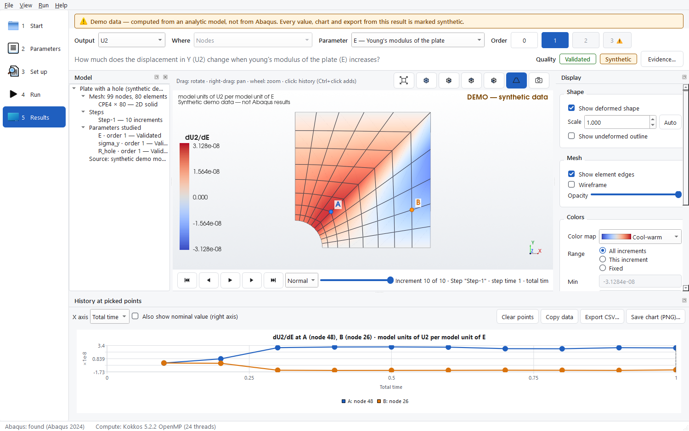

# Abaqus Black-Box Sensitivity Studio (ABSS)

ABSS is a native C++20 / Qt 6 / VTK / Kokkos desktop application. It computes how **every result of an Abaqus/Standard
analysis, at every accepted increment, changes when a model parameter changes**. It supports first- and second-order
derivatives with respect to material constants, opaque UMAT/UEL `PROPS`, loads, boundary conditions, section
properties and geometry. You open one INP file, pick parameters from an automatically discovered list, choose the
derivative order and press **Run**. The results are then explored in the same window as 2D/3D colour maps and
history charts.

ABSS does **not** re-implement any Abaqus element or material. Abaqus is used as an opaque *residual and tangent
oracle*. ABSS prescribes displacements, reads reaction forces (`r = −RF`), replays perturbed load histories through
restarts, and solves the history-consistent sensitivity equations itself (see [docs/SCIENCE.md](docs/SCIENCE.md)).
Everything runs locally. Nothing is uploaded anywhere.



## What is verified, and what is not

| Capability | Status | Evidence |
|---|---|---|
| Sensitivity engine (orders 1–2; history-consistent probe/commit branches) on synthetic J2-plasticity models (truss, plane-strain plate, 3D hexahedral cantilever) with loading, unloading and reloading | **Validated**: every increment and every field (U, RF, S, E, PEEQ, Mises) against full reruns, typically 1e-6 to 1e-8 relative | `ctest`, [VALIDATION_RESULTS](docs/VALIDATION_RESULTS.md) §2 |
| Analytic checks (truss): `du/dE`, `d²u/dE²`, `d³u/dE³`, `du/dF`, parameter-dependent prescribed BC, reaction sensitivity | **Validated** (synthetic, exact formulas) | `test_engine.cpp` |
| Mixed second derivatives (∂²/∂a∂b, by polarization) | **Validated** on the J2 plate against 4-corner reruns (4.6e-7) | `test_mixed.cpp` |
| Inconsistent tangent (Abaqus gives the elastic K under plasticity) handled with matrix-free GMRES | **Validated** on synthetic J2 models with a deliberately elastic tangent; a negative control fails without it | `test_krylov.cpp` |
| **Real Abaqus 2024**: truss (T2D2) `du/dE`, `d²u/dE²`, `du/dF` against analytic formulas; tangent check | **Validated** | ctest label `abaqus`, VALIDATION_RESULTS §3 |
| **Real Abaqus 2024**: CPS4 J2 plasticity, 20 increments with load/unload; E, σ_y, prescribed displacement, order 1 | **Validated**: every increment and every field against full Abaqus reruns (5.0e-4, 3.2e-4, 1.6e-5). Abaqus's elastic tangent was detected at all 11 plastic increments and corrected with GMRES | VALIDATION_RESULTS §3.3 |
| Real Abaqus order 2 beyond the elastic truss | not yet run (cost: about 3× the order-1 jobs) | ABAQUS_REQUIRED_TESTS |
| Order 3 | **Experimental** (exact on the analytic truss; not validated on real Abaqus) | |
| **Real Abaqus 2024**: UMAT and UEL with opaque `PROPS`, each given as Fortran source, as an `.obj` only, and as a prebuilt library only (no source, no object) | **Validated** (order 1): analytic `dU/dPROPS` to 1e-6 relative for all six runs; the three forms agree to 1e-10 | `test_abaqus_usersub.cpp`, VALIDATION_RESULTS §3.5 |
| **Real Abaqus 2024**: part/assembly/instance decks (rotated instances, label gaps), steps and assemblies in `*INCLUDE` files | **Validated** (5.5e-7 on the instance and include models) | VALIDATION_RESULTS §3.6 |
| **Real Abaqus 2024**: material bridge for compiled materials Abaqus cannot load (Linux `.so` under WSL, or a `.dll` with its own interface) | **Validated** with a Windows test library (1.5e-6); the Linux/WSL path awaits WSL on the test machine | §3.6 |
| **Real Abaqus 2024**: implicit `*DYNAMIC` (HHT), NLGEOM; derivatives w.r.t. E and density | **Validated** (8e-9, 9e-9) | §3.6 |
| **Real Abaqus 2024, verification package**: TIE + coupling, large-rotation shell, contact, released BCs, thermal stress with step temperatures, `*VISCO` creep, follower pressure, implicit dynamics, UMAT, UEL, bridge, assemblies, includes, plasticity | **16 models, 39 derivatives, all Validated** (worst 4.3e-4, most 1e-7..1e-10) | VALIDATION_RESULTS §3.7, `dist\ABSS-Verification` |
| Speed | On the small verification models ABSS is **1.3–61× slower** than finite differences of full Abaqus reruns (start-up overhead of many single-increment jobs); large-model crossover not yet measured | VALIDATION_RESULTS §3.8 |
| *EQUATION, *MPC, distributing coupling, rigid bodies, non-TABULAR amplitudes other than SMOOTH STEP | **Implemented**, unit-tested, guarded by the run-time replay check; not yet run on Abaqus | ABAQUS_REQUIRED_TESTS C5, C11 |
| RIKS, explicit dynamics, heat transfer, dynamics combined with constraints | **Refused with the reason** | KNOWN_LIMITATIONS |

Every result in the app carries its own evidence badge: **Validated**, **Experimental**, **Unverified**, **Failed**
or **Synthetic**. The badge comes with notes, including suspect increments flagged by the non-smoothness detector.

## Installation

One file per platform does everything; `scripts\package.ps1` builds both into `dist\`.

| Platform | Run | What it does |
|---|---|---|
| **Windows** | `ABSS-Setup-<version>.exe` | One administrator prompt. Installs the application, the examples, the ELF host for Linux material libraries, and the compilers for user subroutines (Microsoft C++ Build Tools, Intel Fortran). Missing compilers are downloaded and installed silently after one licence consent; the Intel download is checked against its published SHA-256 and the Microsoft one by its signature. Unattended deployment: `ABSS-Setup-<version>.exe /S /ACCEPT_LICENSES`. |
| **Linux workstation** | `bash ABSS-Installer-Linux-<version>.run` | No root rights. Downloads a private toolchain into `~/abss` (micromamba + conda-forge: compilers, CMake, Qt 6, VTK, Kokkos/OpenMP, SuiteSparse, OpenBLAS…), builds ABSS, runs its tests, installs `abss` and `abss-cli`, a desktop entry and a PATH entry, and records the Abaqus it finds. |
| **HPC cluster** | the same `.run` on a login node | Detects the scheduler (Slurm/PBS/LSF) or the missing display and builds the headless `abss-cli`. Writes an environment module (`module use ~/abss/modulefiles && module load abss`) and a Slurm template (`~/abss/share/abss/hpc/abss_slurm.sh`). Finds Abaqus through `ABSS_ABAQUS_CMD`, PATH or `module load abaqus`, which the launchers then load automatically. |

Options (Linux): `--prefix DIR`, `--cli-only`, `--gui`, `--jobs N`, `--abaqus CMD`, `--no-tests`, `--toolchain DIR`.
On Linux, compiled material libraries (`.so`) are loaded in-process by a generated UMAT, so no helper is needed.

The Windows compilers can be checked or installed again later with `tools\toolchain.ps1 -Install` from the install
folder.

**From source, automatically:** `powershell -ExecutionPolicy Bypass -File scripts\setup_dependencies.ps1
[-UserSubroutines]`. This finds or downloads MSYS2, its packages and Kokkos, optionally the compilers, then builds and
tests ABSS. The manual steps it automates are:

1. **MSYS2 UCRT64** (user-local install, no admin needed):
   ```powershell
   $tc = "$env:USERPROFILE\toolchains"
   Invoke-WebRequest https://repo.msys2.org/distrib/msys2-x86_64-latest.sfx.exe -OutFile $tc\msys2.sfx.exe
   & $tc\msys2.sfx.exe -y "-o$tc\"
   & $tc\msys64\usr\bin\bash.exe -lc "pacman -Syu --noconfirm"
   & $tc\msys64\usr\bin\bash.exe -lc "pacman -S --noconfirm --needed mingw-w64-ucrt-x86_64-{gcc,cmake,ninja,qt6-base,qt6-charts,qt6-svg,vtk,eigen3,suitesparse,nlohmann-json,doctest}"
   ```
2. **Kokkos with OpenMP.** The MSYS2/Trilinos Kokkos is Serial-only, so build Kokkos yourself:
   ```powershell
   & $tc\msys64\usr\bin\bash.exe -lc 'export PATH=/ucrt64/bin:$PATH; cd /c/Users/$USER/toolchains && curl -LO https://github.com/kokkos/kokkos/releases/download/5.2.2/kokkos-5.2.2.tar.gz && tar xzf kokkos-5.2.2.tar.gz && cmake -S kokkos-5.2.2 -B kokkos-build -G Ninja -DCMAKE_BUILD_TYPE=Release -DCMAKE_CXX_STANDARD=20 -DKokkos_ENABLE_OPENMP=ON -DCMAKE_INSTALL_PREFIX=$HOME/../../c/Users/$USER/toolchains/kokkos-openmp && cmake --build kokkos-build && cmake --install kokkos-build'
   ```
   The toolchain file picks up `%USERPROFILE%\toolchains\kokkos-openmp` automatically. Without Kokkos, ABSS builds
   with serial CPU kernels (`-DABSS_WITH_KOKKOS=OFF`).
3. **Abaqus** (optional): only needed for new analyses. ABSS finds `C:\SIMULIA\Commands\abaqus.bat`, or set
   `ABSS_ABAQUS_CMD`.

Linux: `scripts/build_linux.sh` (needs Qt6, VTK with GUISupportQt, Eigen, nlohmann_json, doctest; optional
SuiteSparse and Kokkos).

## Build and test

```powershell
powershell -ExecutionPolicy Bypass -File scripts\build.ps1          # configure + build + ctest (excludes the Abaqus test)
```
or manually (PowerShell needs the quotes around `-D` arguments):
```powershell
$env:PATH = "$env:USERPROFILE\toolchains\msys64\ucrt64\bin;$env:PATH"
cmake -S . -B build -G Ninja "-DCMAKE_TOOLCHAIN_FILE=cmake/msys2-ucrt64.cmake"
cmake --build build
ctest --test-dir build -LE abaqus --output-on-failure   # all tests that do not need Abaqus
ctest --test-dir build -L abaqus --output-on-failure    # real Abaqus test (~2 min, uses licence tokens)
```
Package a self-contained folder and zip (all DLLs, Qt plugins, examples, docs): `scripts\package.ps1`.

## First launch and demo walkthrough

```powershell
$env:PATH = "$env:USERPROFILE\toolchains\msys64\ucrt64\bin;$env:PATH"
.\build\bin\abss.exe
```
1. **Start**: shows whether Abaqus was found ("Check now" tests the licence with a one-element job), the compute
   backend and the sparse solvers. Choose *Plate with a hole* and press **Run demo and show results**. No Abaqus is
   needed; the demo is a built-in synthetic J2 model and is labelled as such everywhere.
2. **Parameters**: a searchable table grouped by category, with confidence badges (known meaning vs. opaque
   `PROPS[k]`) and the source `file:line` of every value.
3. **Set up**: the derivative order (0–2; 3 is marked Experimental), outputs, "Validate against full reruns", and a
   cost estimate (oracle evaluations / Abaqus jobs).
4. **Run**: progress, a live log and Cancel. The interface stays responsive (the work runs on a worker thread).
5. **Results**: choose the output (U2, S11, Mises, PEEQ…), the parameter and the order (for example `dU2/dE`).
   - **Colouring:** palettes, a diverging range centred at zero for derivatives, and range modes (all increments,
     this increment, fixed). Integration-point data is shown either as an element average, labelled as a
     projection, or at a single chosen point.
   - **History:** click points on the mesh to plot histories over all increments; Ctrl+click compares points.
   - **Export:** CSV, PNG and VTU. Save as `.abss`, which reopens without Abaqus.

Unattended example: `abss.exe --demo plate --run --pick 2 --screenshot shot.png --quit`.

## Running a real Abaqus model

GUI: **File → Open** an `.inp`, select parameters, then Run. CLI:
```powershell
.\build\bin\abss-cli.exe inspect examples\models\truss.inp                  # list parameters and their ids
.\build\bin\abss-cli.exe run examples\models\truss.inp --params "mat:STEEL:elastic:E,load:LOAD:cload:TIP:1" `
     --order 2 --jobs 4 --validate --out truss.abss
.\build\bin\abss-cli.exe show truss.abss                                    # evidence summary, no Abaqus needed
```
- **Inputs.** Flat or part/assembly decks, with or without `*INCLUDE`s, using `*STATIC`, `*VISCO` or implicit
  `*DYNAMIC` steps, constraints, contact, and `*BOUNDARY`/`*CLOAD`/`*DLOAD`/`*DSLOAD`/`*TEMPERATURE` loading with any
  analytic amplitude. The exceptions are in KNOWN_LIMITATIONS. The original INP is never modified; edited and
  flattened copies live in the scratch folder.
- **User subroutines.** For a UMAT/UEL model, pass `--user` (GUI: Set up ▸ Abaqus ▸ User subroutine) with one of:
  - Fortran or C source (`.f`, `.for`, `.f90`, `.c`, `.cpp`);
  - an object file (`.obj`), without its source;
  - a folder containing a prebuilt `standardU.dll`, or the DLL itself. No compiler is needed for this.

  ABSS builds the library once per run and gives it to every Abaqus job through `usub_lib_dir`. If the Abaqus
  installation has its user-subroutine development files, ABSS uses `abaqus make` (configured for `ifx` when
  `ifort` is absent). Otherwise it builds `standardU.dll` directly: it compiles with the Abaqus flags, then links
  your routines together with thunks that forward every other entry point to Abaqus's stub library. The built folder
  (`standardU.dll` + `abss_abqstub.dll`) can be reused without the source: `abss-cli usersub my_umat.f --out lib`.
  PROPS are differentiated as opaque indexed constants.
- **Compiled materials Abaqus cannot load (material bridge).** Pass the library, or its vendor package folder, as
  the user subroutine. That can be a Linux `.so`, or a Windows `.dll` that exports a standard UMAT or a
  deformation-gradient update plus a state initialiser (for example `ti_regular` / `ti_reg_sdvini`). ABSS generates
  a UMAT/SDVINI `standardU.dll` that forwards every material-point call to a helper process running the library.
  A Linux `.so` runs natively in ABSS's ELF host (`abss_elfhost.exe`, installed with ABSS, no WSL needed). A `.dll`
  runs under Abaqus's own Python. Sizes declared in a header next to the library (`#define …_NTENS/_NSTATV/_NPROPS`)
  are checked against the deck. Linux libraries that read input files, or need imports the ELF host does not
  provide, run under WSL instead (administrator: `wsl --install -d Ubuntu`, then in Ubuntu
  `sudo apt install python3 liblapack3 libblas3 libgfortran5`).
- **Cost.** Every probe and commit is evaluated by Abaqus jobs. Each job pays about 11 s of driver start-up, licence
  checkout, input processing and wrap-up, plus Abaqus/Standard's own time (≈ 5 s on small models). That is about
  16 s per job on small models, measured over 6,065 jobs on the development PC (docs/PERFORMANCE.md).
  - `--jobs N` runs N jobs at once, licence permitting.
  - Each branch's commit for an increment and its probe for the next increment share one job.
  - `--batch` puts several history branches into each job as separate copies of the model. A step of the method
    then costs one job per slot instead of one job per branch, with identical results. It applies to flat decks;
    other decks fall back automatically, and the log says so.
- **Baseline and diagnostics.**
  - `abss-cli fafd <model.inp> --params ...` computes full-analysis central finite differences for comparison. This
    is not ABSS, and its output is labelled FAFD.
  - `abss-cli compare a.abss b.abss` reports field-by-field agreement.
  - `--profile run.json` records where a run's time went.

  The ABSS-vs-FAFD benchmark campaign is in `benchmarks/nasa_stri/`.

## Repository layout
`include/abss`, `src/{core,inp,linalg,oracle,sensitivity,viz,gui}`, `apps/{abss,cli}`, `tests/{core,inp,linalg,oracle,sensitivity,gui,abaqus}`,
`examples/{models,subroutines}`, `validation/` (Council experiments and reference models), `docs/`, `scripts/`,
`cmake/`, `reference/` (the original Plotly viewer, kept for reference only).

## Documentation
[SCIENCE](docs/SCIENCE.md) · [ARCHITECTURE](docs/ARCHITECTURE.md) · [VALIDATION_RESULTS](docs/VALIDATION_RESULTS.md) ·
[KNOWN_LIMITATIONS](docs/KNOWN_LIMITATIONS.md) · [ABAQUS_REQUIRED_TESTS](docs/ABAQUS_REQUIRED_TESTS.md) ·
[COUNCIL_REVIEW](docs/COUNCIL_REVIEW.md)
